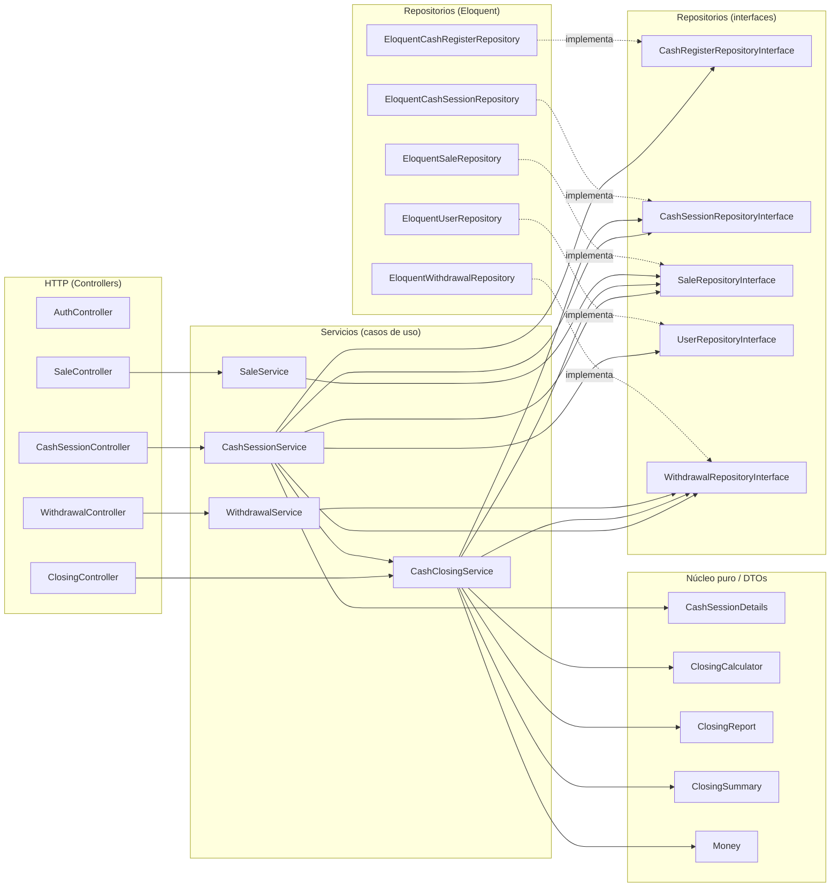

# Documentación — Caja de tienda de repuestos

Sistema web (Laravel 12 + PostgreSQL) para controlar la caja de una tienda: abrir turno, registrar ventas (efectivo/QR) y salidas, cerrar en modo **normal** o **ciego** y mostrar a la dueña si la caja cuadra y por cuánto.

- [1. Requisitos](#1-requisitos)
- [2. Ejecutar con Docker (recomendado)](#2-ejecutar-con-docker-recomendado)
- [3. Ejecutar localmente sin Docker](#3-ejecutar-localmente-sin-docker)
- [4. Probar el sistema (guía de uso)](#4-probar-el-sistema-guía-de-uso)
- [5. Tests](#5-tests)
- [6. Arquitectura](#6-arquitectura)
- [7. Reglas de negocio](#7-reglas-de-negocio)
- [8. Rutas](#8-rutas)
- [9. Problemas frecuentes](#9-problemas-frecuentes)

---

## 1. Requisitos

| Modo | Necesitas |
|---|---|
| Docker | Docker Desktop (o Docker Engine) con Compose v2. Nada más. |
| Local | PHP **8.2+** (extensiones `pdo_pgsql`, `mbstring`, `xml`, `zip`, `curl`), Composer 2, PostgreSQL **14+** |

La interfaz carga Pico.css desde un CDN: para verla con estilos hace falta internet (sin él funciona igual, sin estilos).

---

## 2. Ejecutar con Docker (recomendado)

```bash
git clone <tu-repo> && cd <tu-repo>
docker compose up --build
```

Qué hace por ti, en orden: construye la imagen PHP 8.3 → arranca PostgreSQL 16 (crea las bases `caja` y `caja_test`) → espera a que la base esté sana → crea `.env` y la `APP_KEY` si faltan → ejecuta `php artisan migrate --seed --force` (carga el **día de prueba**) → sirve la app.

Abre **http://localhost:8000**.

| Usuario | Correo | Contraseña |
|---|---|---|
| Dueña (propietaria) | `owner@tienda.test` | `password` |
| Cajero | `cajero@tienda.test` | `password` |

### Comandos útiles

```bash
docker compose up -d --build                    # en segundo plano
docker compose logs -f app                      # ver logs de la app
docker compose exec app php artisan test        # correr los tests (usa la BD caja_test)
docker compose exec app php artisan migrate:fresh --seed   # reiniciar datos de desarrollo
docker compose exec app bash                    # entrar al contenedor
docker compose exec db psql -U caja -d caja     # entrar a PostgreSQL
docker compose down                             # parar (conserva los datos)
docker compose down -v                          # parar y BORRAR datos (reinicio total)
```

Notas:
- El código está montado en el contenedor (`.:/var/www`): los cambios en PHP/Blade se ven al recargar, sin reconstruir. Si cambias `composer.json`, ejecuta `docker compose up --build`.
- Reiniciar el contenedor **no duplica** el día de prueba (el seeder es idempotente).
- Si el volumen de la base ya existía antes de agregar `init.sql`, la base `caja_test` no se creó: usa `docker compose down -v`.

---

## 3. Ejecutar localmente sin Docker

### 3.1 Base de datos
```bash
psql -U postgres -c "CREATE USER caja WITH PASSWORD 'secret' SUPERUSER;"
psql -U postgres -c "CREATE DATABASE caja OWNER caja;"
psql -U postgres -c "CREATE DATABASE caja_test OWNER caja;"
```

### 3.2 Aplicación
```bash
composer install
cp .env.example .env
php artisan key:generate
```
Edita `.env` y cambia **solo el host** (el ejemplo apunta al contenedor `db`):
```dotenv
DB_HOST=127.0.0.1
DB_PORT=5432
DB_DATABASE=caja
DB_USERNAME=caja
DB_PASSWORD=secret
```
Luego:
```bash
php artisan migrate --seed    # crea tablas y carga el día de prueba
php artisan serve             # http://127.0.0.1:8000
```

### 3.3 Tests
```bash
php artisan test
```
`phpunit.xml` fuerza la base `caja_test` (nunca toca `caja`), así que debe existir (paso 3.1).

### 3.4 Reiniciar datos
```bash
php artisan migrate:fresh --seed
```

---

## 4. Probar el sistema (guía de uso)

### 4.1 El día de prueba ya cargado
1. Entra como **dueña** → lista de turnos → **Ver resumen** del turno #1.
2. Arriba del resumen: **Se ganó Bs 3.050,00 · Se inició con Bs 300,00 · En total Bs 3.350,00**, y el turno *de 08:00 a 20:00 · Tiempo trabajado: 12 hr 0 min*.
3. Después: *Faltante de Bs 70,00*; esperado en caja Bs 2.250; contado Bs 2.180.
4. La cita de la dueña, tal como ella lo dijo: *"Vendí Bs 3.050, más los Bs 300 de cambio son Bs 3.350, y el cajero contó Bs 2.180. ¡Me faltan Bs 1.170!"*
5. La tabla *¿Qué pasó realmente?* explica por qué no son 1.170:

| Concepto | Bs |
|---|---|
| Su cuenta: 3.050 + 300 − 2.180 | 1.170 |
| − Ventas por QR (nunca entran al cajón) | −900 |
| − Salida pagada al proveedor | −200 |
| **= Faltante real** | **70** |

### 4.1b Turno anterior y monto inicial secuencial
Al abrir un turno, cada caja libre **propone el fondo con que empezó su turno anterior** (si el último empezó con Bs 250, propone 250; la primera vez, 300). Se puede cambiar.
La **dueña** además ve, sobre el formulario, cómo le fue a ese turno: *se inició con · se ganó · en total* y *trabajó de HH:MM a HH:MM (tiempo trabajado)*. El cajero no ve esas cifras (podrían revelar datos de una caja ciega).
El tiempo se muestra así: `3 hr 34 min` · `0 hrs 2 min` · `0 hrs 0 min 30 seg`.

### 4.2 Caja ciega (la cierra el cajero)
1. Como **dueña**: *Abrir un turno de caja* → caja, cajero, fondo 300, modo **Caja ciega**.
2. Sal e ingresa como **cajero** → abre el turno → registra ventas y una salida.
3. *Cerrar caja*: solo ves un campo para el efectivo contado. Ninguna pantalla muestra esperado, totales ni diferencia.
4. Como **dueña**: *Ver resumen* del turno cerrado.

### 4.3 Caja normal (la cierra la dueña)
Abre un turno en modo **Caja normal**. Como dueña, *Cerrar caja* muestra el esperado mientras cuentas y el resumen aparece al instante. El cajero **no** puede cerrarla.

### 4.4 Varias cajas
Hay dos cajas sembradas (*Caja Principal*, *Caja 2*). Cada caja admite **un** turno abierto; cajas distintas pueden estar abiertas a la vez. Una caja con turno abierto no aparece en el selector hasta que se cierre.

---

## 5. Tests

| Archivo | Qué prueba |
|---|---|
| `Unit/ClosingCalculatorTest` | Fórmulas, conciliación, `Money` y el mensaje exacto de la dueña (*¡Me faltan Bs 1.170!*) |
| `Unit/DurationTest` | Formato del tiempo trabajado (`3 hr 34 min`, `0 hrs 2 min`, `0 hrs 0 min 30 seg`) |
| `Feature/ClosingTestDayTest` | **El día de prueba**: seeder, esperado 2.250, faltante 70 (no 1.170), cita de la dueña, *se ganó / se inició / en total*, 12 hr 0 min, idempotencia |
| `Feature/BlindModeTest` | Caja ciega: el cajero no ve cifras en **ninguna** pantalla (ni cerrada), la vista no recibe resumen ni snapshots, quién puede cerrar cada modo |
| `Feature/CashSessionRulesTest` | Una sesión abierta por caja (servicio + índice de PostgreSQL), varias cajas, validaciones, **salida mayor al efectivo**, **montos negativos/mal formados**, fondo secuencial y turno anterior, varios dueños |
| `Feature/LayeringTest` | Bindings de repositorios, visibilidad por rol en el servicio, servicio con repositorio falso |

---

## 6. Arquitectura

**MVC con capa de servicios y repositorios, más un núcleo de cálculo puro.** Cada capa solo conoce a la de abajo:

```
Controller (HTTP)  →  Service (casos de uso)  →  Repository (interfaz)  →  Eloquent / PostgreSQL
                              └──────────────→  Núcleo puro (ClosingCalculator, Money, DTOs)
```

Grafo de dependencias real (generado leyendo los `use` del código; no hay controlador que importe un repositorio):



### Dónde está cada cosa
```
app/Http/Controllers/   AuthController · CashSessionController · SaleController · WithdrawalController · ClosingController
app/Http/Requests/      validación de formularios (4)
app/Services/           CashSessionService · SaleService · WithdrawalService · CashClosingService
app/Repositories/       Contracts/ (interfaces) · Eloquent/ (implementaciones)
app/Support/            Money · ClosingCalculator · ClosingSummary · ClosingReport · CashSessionDetails
app/Models/ Enums/ Policies/
database/               migrations · seeders (Users, CashRegister, TestDay) · factories
resources/views/        layouts · auth · cash (index, show, close, summary)
```

### Patrones
Service Layer · Repository (interfaz + Eloquent, enlazado en `AppServiceProvider::$bindings`) · DTO inmutable · Núcleo funcional (`ClosingCalculator`) · Policy · Form Request · Enums · Seeder que reutiliza los servicios.

### Modelo de datos
`users(role)` · `cash_registers` · `cash_sessions` (caja, cajero, fondo, modo, estado, snapshots del cierre) · `sales` · `withdrawals`. Dinero en `decimal(12,2)`; en cálculos, centavos enteros (sin `float`).
Índice único parcial: `cash_sessions(cash_register_id) WHERE status='open'`.

---

## 7. Reglas de negocio

- **Esperado en caja** = fondo inicial + ventas en efectivo − salidas. El **QR no entra** al cajón.
- **Diferencia** = contado − esperado → `0` cuadra · `< 0` faltante · `> 0` sobrante.
- **Caja normal:** cierra la dueña, viendo el esperado. **Caja ciega:** cierra el cajero asignado sin ver nada; solo la dueña ve el resumen.
- **Ciego en el servidor:** `CashSessionService::details()` no entrega al cajero resumen, listas ni los montos guardados del cierre.
- **Una sesión abierta por caja** (validación + índice de PostgreSQL). Varias cajas, varios propietarios y varios cajeros.
- Caja cerrada = inmutable. Al cerrar se guardan el esperado, el contado y la diferencia.
- **Sin montos negativos (RN-11):** ventas y salidas deben ser > 0; fondo y conteo ≥ 0; formato `123` o `123.45` (nada de signos, exponentes ni más de 2 decimales). Se valida en el formulario **y** en los servicios.
- **Una salida no puede superar el efectivo de la caja (RN-12):** disponible = fondo + ventas en efectivo − salidas previas (el QR no cuenta). La dueña ve el disponible en el mensaje; el cajero de una caja ciega recibe el aviso **sin cifras**. Se bloquea la fila del turno para que dos salidas simultáneas no se pasen.
- **Monto inicial secuencial (RN-13):** cada caja propone su fondo habitual (el último con que la dueña la abrió); la dueña ve su resumen (ganó, inició, total, horario y tiempo trabajado).

## 8. Rutas

| Método | Ruta | Quién |
|---|---|---|
| GET/POST | `/login` · POST `/logout` | público / autenticado |
| GET | `/` | redirige según el rol: dueña → `/panel`, cajero → `/mi-turno` |
| GET | `/mi-turno` | **cajero**: estado del turno (sin turno / fondo por confirmar / operando) |
| POST | `/mi-turno/abrir` | cajero: abre una caja libre con el fondo habitual (siempre ciega) |
| POST | `/mi-turno/fondo/confirmar` · `/mi-turno/fondo/no-coincide` | cajero: confirma o discute el fondo recibido |
| POST | `/mi-turno/ventas` · `/mi-turno/salidas` | cajero (turno abierto); no hay ids de turno en la URL |
| POST | `/mi-turno/ventas/{id}/anulacion` · `/mi-turno/salidas/{id}/anulacion` | cajero: *solicita* la anulación con una nota |
| GET | `/mi-turno/cierre` | cajero, solo caja ciega: planilla de billetes y monedas |
| POST | `/mi-turno/cierre/revisar` · `/mi-turno/cierre` | cajero: «Contaste Bs X» (no escribe) · enviar el cierre |
| GET | `/panel` | **dueña**: cajas, turnos activos, abrir turno, historial |
| POST | `/panel/turnos` | dueña: abre el turno (queda *por confirmar*) |
| GET | `/panel/turnos/{id}` | dueña: detalle o resumen del cierre |
| PATCH | `/panel/turnos/{id}/fondo` | dueña: corrige el fondo de un turno por confirmar |
| GET / POST | `/panel/turnos/{id}/cerrar` | dueña, solo caja normal |
| POST | `/panel/turnos/{id}/revision` | dueña: Revisado / Observado (con comentario) |
| POST | `/panel/ventas/{id}/anular` · `/panel/salidas/{id}/anular` | dueña: anula con motivo (nada se borra) |
| GET | `/panel/historial` | dueña: turnos cerrados por cajero, caja, fechas y revisión |
| GET | `/panel/bitacora` | dueña: quién hizo qué y cuándo |
| PATCH | `/panel/cajas/{id}/fondo` | dueña: fondo habitual de la caja |

El rol equivocado recibe **403** en cada zona (middleware `role:cashier` / `role:owner`; `RoleZonesTest` recorre todas las rutas).

## 9. Problemas frecuentes

| Síntoma | Causa / solución |
|---|---|
| `port is already allocated` (5432 u 8000) | Cambia el puerto izquierdo en `docker-compose.yml` (`"5433:5432"`, `"8001:8000"`) |
| `could not find driver` (local) | Falta la extensión `pdo_pgsql` de PHP |
| `SQLSTATE connection refused` (local) | `DB_HOST` debe ser `127.0.0.1`, no `db` |
| `database "caja_test" does not exist` | Docker: `docker compose down -v && docker compose up --build`. Local: crea la base (3.1) |
| Pantalla sin estilos | Sin internet no carga el CDN de Pico.css; la app funciona igual |
| `No application encryption key` | `php artisan key:generate` |
| `permission denied` en `storage/` | `chmod -R 775 storage bootstrap/cache` |
| `bash: docker/entrypoint.sh: Permission denied` | `chmod +x docker/entrypoint.sh` (el Dockerfile ya lo invoca con `bash`) |


## 10. Fases 2–4 de la propuesta (implementadas)

- **Revisión (Fase 2):** todo cierre queda *Pendiente de revisión*; la dueña lo marca *Revisado* u *Observado* (con comentario). Si la dueña cierra un turno normal, queda *Revisado*.
- **Anulación:** nada se borra. La dueña anula con motivo (sale de los totales, queda tachado); el cajero solo *solicita* la anulación. Bitácora de acciones en `/panel/bitacora`.
- **Conteo por denominaciones (Fase 3):** el cajero cuenta billetes y monedas, ve «Contaste Bs X» y recién entonces envía; el total lo calcula siempre el servidor. Teclado numérico en la venta; categoría en las salidas.
- **Tolerancia y alertas (Fase 4):** `config/caja.php` (tolerancia Bs 5, faltantes repetidos, acumulados, salidas altas, horas límite, anulaciones). La tolerancia solo cambia la etiqueta; la diferencia exacta se guarda y se muestra a la dueña.
